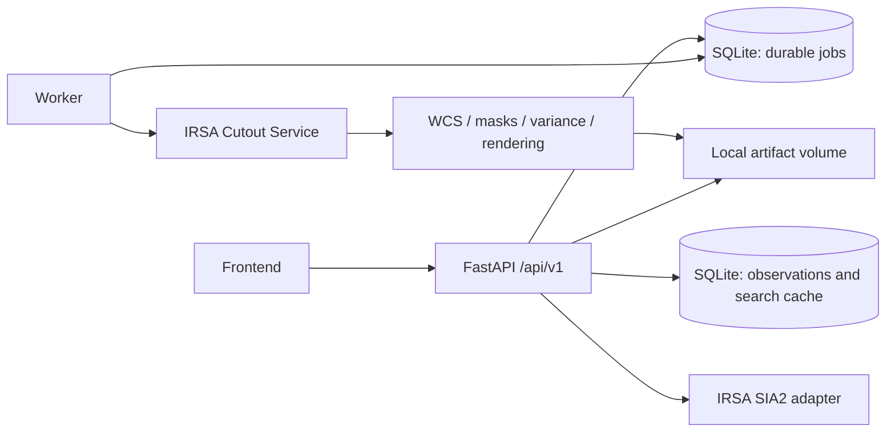

# Архитектура

Выбран модульный бэкенд FastAPI и один отдельный процесс обработки. Для первого этапа
не нужны PostgreSQL, Redis, S3 или учётные записи внешних сервисов.

Дополнительный адаптер NEOSSat (`providers/neossat.py`) работает через CADC ObsTAP
и DataLink параллельно с основным провайдером. Источник задаётся полем `source`
в запросе поиска и задачи; по умолчанию сохраняется SPHEREx. Отдельный модуль
`neossat_science.py` создаёт вырезки/blink в counts без слоёв SPHEREx и выдуманных
дисперсий. Подробности и ограничения: [NEOSSat](neossat.md).

## Поток данных

Поиск ограничен координатами и `MAXREC`. Адаптер переводит SIA ObsCore в публичную
модель: метры → микрометры, временные границы сохраняет в MJD. Поиск регистрирует
наблюдения в SQLite и кэширует ответ на 15 минут. ID — стабильный хэш архивного URL;
смена версии файла создаёт другой ID. Изменение коллекций/провайдера меняет ключ кэша.

API принимает только ID уже найденных наблюдений, проверяет провайдера и детектор.
Worker получает оригинальный URL из хранилища, запрашивает маленькую вырезку,
приводит её к общей ICRS/TAN сетке и создаёт производные файлы. Произвольные URL
и загрузка пользовательских FITS через API не поддерживаются.

## Хранилище и очередь

`data/spherex.sqlite3`: наблюдения, кэш запросов, очередь задач. Схема имеет
`PRAGMA user_version=1`; будущие изменения должны поставляться с миграциями.
SQLite работает в WAL, каждая операция использует своё соединение. `BEGIN IMMEDIATE`
защищает приём задачи с проверкой ёмкости очереди и атомарное получение worker.

Жизненный цикл: `queued → running → succeeded | failed`.
Worker обновляет lease; после его истечения задача вновь доступна. После трёх
потерянных попыток задача становится `failed`. Обычная ошибка обработки сразу завершает
задачу с ошибкой; автоматических бесконечных повторов нет.

Файлы: `data/artifacts/<job_id>/<attempt>/`. API отдаёт только файлы из manifest
успешной задачи. Попытки имеют отдельные каталоги; поздняя запись потерянного worker
не может изменить текущий результат. Задачи переживают перезапуск API/worker.
При аварии worker восстановление происходит после истечения lease (по умолчанию 30 минут).

## Обработка изображений

- `IMAGE`, `VARIANCE`, `FLAGS` читаются по имени HDU. Включённое вычитание фона требует `ZODI`.
- Единицы поверхности яркости приводятся к MJy/sr; отсутствующие/несовместимые единицы — ошибка.
- Билинейная интерполяция использует celestial WCS, включая доступные искажения исходного FITS.
- Дисперсия переносится как сумма `weight² × variance`; входные соседние пиксели считаются независимыми.
- По умолчанию отклоняются все флаги, кроме информационного source-mask bit 21.
- Интерполяция через отсутствующие или отклонённые пиксели не заполняет пропуски.
- Стек — среднее с весами `1/variance`; разность — второй кадр минус первый, дисперсии складываются.
- Общая шкала растяжения для blink сохраняет сравнимость яркости PNG между кадрами.
- В PNG вертикальная ось перевёрнута относительно FITS-массива: север сверху, восток слева.
- `COVERAGE`: для стека количество пригодных входов, иначе сумма весов пригодных соседей.
  `NaN` в IMAGE обозначает отсутствие пригодного результата, а не нулевой поток.

Это приближённая обзорная обработка. Ковариации после интерполяции, ошибки ZODI,
PSF matching, фильтрация выбросов и спектральное согласование не моделируются.

## Эксплуатация

API и worker запускаются из одной версии исходников и используют один локальный том.
Несколько процессов могут атомарно получать разные задачи, но целевая конфигурация MVP —
один API и один worker. SQLite и общий диск не предназначены для разных серверов или NFS.

Текущие ограничения: 500 записей поиска, радиус до 2°, до 12 кадров на задачу,
поле до 0.5°, до 512×512 пикселей, до 64 MiB на один ответ загрузки, 100 активных задач.
FITS загружаются последовательно и освобождаются после перевода в выходную сетку.
Новые результаты на диск сохраняются без автоматической очистки. Нужны наблюдение за диском,
резервные копии SQLite вместе с WAL и политика хранения результатов перед публичным запуском.

`/health/live` проверяет процесс; `/health/ready` — доступность SQLite, без обращения
к IRSA и без гарантии работы worker. Идентификатор запроса возвращается в `X-Request-ID`;
worker пишет ID задачи и ошибки в стандартный журнал.

Сервис не имеет авторизации, квот на пользователя и ограничения запросов в секунду.
По умолчанию слушает localhost; Docker также публикует порт только на loopback.
Публичное размещение требует TLS, reverse proxy с rate/body limits, квот задач и диска,
наблюдения за worker и решения о доступе. CORS ограничивает браузеры, но не заменяет авторизацию.
Исходящие загрузки разрешены только с HTTPS-хоста IRSA и пути SPHEREx; редиректы запрещены.

При росте: PostgreSQL для метаданных, внешняя очередь и object storage с теми же
границами адаптера, обработчика и контрактом API. Разделять на микросервисы сейчас не требуется.

## Frontend Mission Control

Четыре режима объединены `frontend/src/App.tsx`. Three.js, Comparator и Spectral Lab
загружаются отдельными модулями. `hooks/usePipeline.ts` управляет общим поиском,
отправкой и опросом задач; `components/common` отображает настоящие артефакты и WCS.
`utils/astronomy.ts` содержит форматирование ICRS/MJD, FITS header parser и явно
модельный Planck-континуум. Он не выполняет фотометрическую калибровку.
Декоративный 3D-мир не используется для научного расчёта положения объектов.
